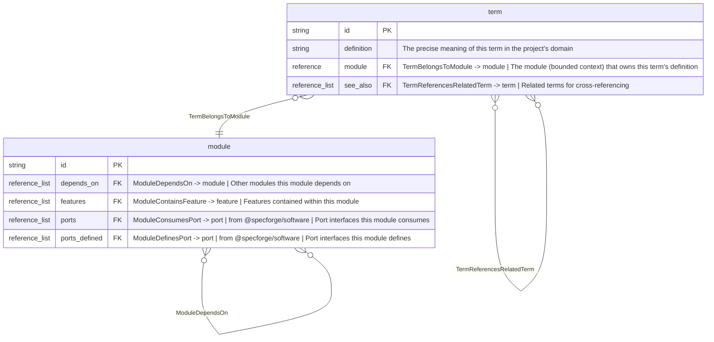

# Model output formats

Every example on this page is real output of `specforge model`, in a project that loads `@specforge/software`
and `@specforge/product` (`specforge init --extensions @specforge/software,@specforge/product`, which also enables
`@specforge/testing`), selecting two product kinds:

```bash
specforge model --kinds term,module --format <FORMAT>
```

The field level is the default, `keys`. Note what the selection does: `module`'s `features` field is listed, but
the `ModuleContainsFeature` relationship is not drawn, because `feature` is not selected. And `module` lists the
two fields `@specforge/software` adds to it (`ports`, `ports_defined`).

## Markdown (default)

For a terminal and for an AI agent: a short preamble on how to read the model, an extension table, then each kind's
fields and relationships.

````markdown
# Logical Data Model

## How to read this model

This document describes the **schema** of a SpecForge project — the entity kinds
(analogous to database tables), their fields (columns), and the relationships
(foreign keys) between them. It does NOT show actual entity instances. Entity
kinds and fields are declared by SpecForge extensions. Relationships have
cardinality: 1:1 (one-to-one), 1:N (one-to-many), N:1 (many-to-one), or
N:M (many-to-many).

## Extensions

| Extension | Version | Entity Kinds | Edge Types |
|-----------|---------|-------------|------------|
| @specforge/product | 1.0.0 | 2 | 3 |
| @specforge/software | 1.0.0 | 0 | 0 |
| @specforge/testing | 1.0.0 | 0 | 0 |

## @specforge/product

### module
*Enhanced by: @specforge/software*

| Field | Type | Required | Contribution | Source | Description |
|-------|------|----------|--------------|--------|-------------|
| id | string | yes |  |  |  |
| depends_on | reference_list(module) | no | ModuleDependsOn -> module |  | Other modules this module depends on |
| features | reference_list(feature) | no | ModuleContainsFeature -> feature |  | Features contained within this module |
| ports | reference_list(port) | no | ModuleConsumesPort -> port | @specforge/software | Port interfaces this module consumes |
| ports_defined | reference_list(port) | no | ModuleDefinesPort -> port | @specforge/software | Port interfaces this module defines |

**Relationships:**
- module --(ModuleDependsOn)--> module [N:M]
- module <--(TermBelongsToModule)-- term [N:1]

### term

| Field | Type | Required | Contribution | Source | Description |
|-------|------|----------|--------------|--------|-------------|
| id | string | yes |  |  |  |
| definition | string | yes |  |  | The precise meaning of this term in the project's domain |
| module | reference(module) | no | TermBelongsToModule -> module |  | The module (bounded context) that owns this term's definition |
| see_also | reference_list(term) | no | TermReferencesRelatedTerm -> term |  | Related terms for cross-referencing |

**Relationships:**
- term --(TermBelongsToModule)--> module [N:1]
- term --(TermReferencesRelatedTerm)--> term [N:M]

2 entity kinds, 3 edge types across 3 extensions.
````

## Mermaid (`erDiagram`)

Extensions are separated by `%%` comments (Mermaid has no namespaces); a kind another extension enhances says so.



| Cardinality | Mermaid |
|-------------|---------|
| 1:1 | `\|\|--\|\|` |
| 1:N | `\|\|--o{` |
| N:1 | `}o--\|\|` |
| N:M | `}o--o{` |

## DOT (Graphviz)

Each extension is a dashed cluster in its declared `theme_color`; each kind's header uses the colour its
declaration gives (`dot_color`). Required fields are bold; reference fields show `-> target`.

```dot
digraph model {
  rankdir=LR;
  node [shape=none, fontname="Helvetica"];
  edge [fontname="Helvetica", fontsize=10];

  subgraph cluster_product {
    label="@specforge/product";
    style=dashed;
    color="#2ecc71";

    module [label=<
      <table border="1" cellborder="0" cellspacing="0">
        <tr><td bgcolor="#607D8B" colspan="5"><font color="white"><b>module (+@specforge/software)</b></font></td></tr>
        <tr><td align="left"><b>id</b></td><td>string</td><td>PK</td><td></td><td></td></tr>
        <tr><td align="left">depends_on</td><td>reference_list</td><td>-&gt; module</td><td><i>ModuleDependsOn -&gt; module</i></td><td></td></tr>
        <tr><td align="left">features</td><td>reference_list</td><td>-&gt; feature</td><td><i>ModuleContainsFeature -&gt; feature</i></td><td></td></tr>
        <tr><td align="left">ports</td><td>reference_list</td><td>-&gt; port</td><td><i>ModuleConsumesPort -&gt; port</i></td><td><font color="gray">@specforge/software</font></td></tr>
        <tr><td align="left">ports_defined</td><td>reference_list</td><td>-&gt; port</td><td><i>ModuleDefinesPort -&gt; port</i></td><td><font color="gray">@specforge/software</font></td></tr>
      </table>
    >];

    term [label=<
      <table border="1" cellborder="0" cellspacing="0">
        <tr><td bgcolor="#795548" colspan="5"><font color="white"><b>term</b></font></td></tr>
        <tr><td align="left"><b>id</b></td><td>string</td><td>PK</td><td></td><td></td></tr>
        <tr><td align="left"><b>definition</b></td><td>string</td><td></td><td></td><td></td></tr>
        <tr><td align="left">module</td><td>reference</td><td>-&gt; module</td><td><i>TermBelongsToModule -&gt; module</i></td><td></td></tr>
        <tr><td align="left">see_also</td><td>reference_list</td><td>-&gt; term</td><td><i>TermReferencesRelatedTerm -&gt; term</i></td><td></td></tr>
      </table>
    >];
  }
  module -> module [label="ModuleDependsOn\n[N:M]"];
  term -> module [label="TermBelongsToModule\n[N:1]"];
  term -> term [label="TermReferencesRelatedTerm\n[N:M]"];
}
```



## JSON

The model itself: extensions with their counts, entities with their fields, relationships with their cardinality.
It is not `specforge schema` (the Graph Protocol schema the model is built from). Here for `--kinds term`:

```json
{
  "schema_version": "1.0.0",
  "extensions": [
    {
      "name": "@specforge/product",
      "version": "1.0.0",
      "entity_count": 1,
      "edge_count": 1
    },
    {
      "name": "@specforge/software",
      "version": "1.0.0",
      "entity_count": 0,
      "edge_count": 0
    },
    {
      "name": "@specforge/testing",
      "version": "1.0.0",
      "entity_count": 0,
      "edge_count": 0
    }
  ],
  "entities": [
    {
      "name": "term",
      "extension": "@specforge/product",
      "dot_color": "#795548",
      "fields": [
        {
          "name": "id",
          "field_type": "string",
          "required": true,
          "is_primary_key": true
        },
        {
          "name": "definition",
          "field_type": "string",
          "required": true,
          "description": "The precise meaning of this term in the project's domain",
          "is_primary_key": false
        },
        {
          "name": "module",
          "field_type": "reference",
          "required": false,
          "description": "The module (bounded context) that owns this term's definition",
          "is_primary_key": false,
          "references": "module",
          "contribution": "TermBelongsToModule -> module"
        },
        {
          "name": "see_also",
          "field_type": "reference_list",
          "required": false,
          "description": "Related terms for cross-referencing",
          "is_primary_key": false,
          "references": "term",
          "contribution": "TermReferencesRelatedTerm -> term"
        }
      ]
    }
  ],
  "relationships": [
    {
      "name": "TermReferencesRelatedTerm",
      "source": "term",
      "target": "term",
      "cardinality": "N:M",
      "source_field": "see_also"
    }
  ]
}
```

## DBML

For [dbdiagram.io](https://dbdiagram.io) and the DBML toolchain: a `TableGroup` per extension, a synthetic
`id varchar [pk]` on every table, `[not null]` on required fields, descriptions as notes, and a named `Ref` per
relationship.

```dbml
// Generated by specforge model
// Schema version: 1.0.0

// ── @specforge/product ──

TableGroup product {
  module
  term
}

Table module { // enhanced by: @specforge/software
  id varchar [pk]
  depends_on text [note: 'ModuleDependsOn -> module | Other modules this module depends on']
  features text [note: 'ModuleContainsFeature -> feature | Features contained within this module']
  ports text [note: 'ModuleConsumesPort -> port | from @specforge/software | Port interfaces this module consumes']
  ports_defined text [note: 'ModuleDefinesPort -> port | from @specforge/software | Port interfaces this module defines']
}

Table term {
  id varchar [pk]
  definition varchar [not null, note: 'The precise meaning of this term in the project\'s domain']
  module varchar [note: 'TermBelongsToModule -> module | The module (bounded context) that owns this term\'s definition']
  see_also text [note: 'TermReferencesRelatedTerm -> term | Related terms for cross-referencing']
}

// ── Relationships ──

Ref ModuleDependsOn: module.depends_on <> module.id
Ref TermBelongsToModule: term.module > module.id
Ref TermReferencesRelatedTerm: term.see_also <> term.id
```
